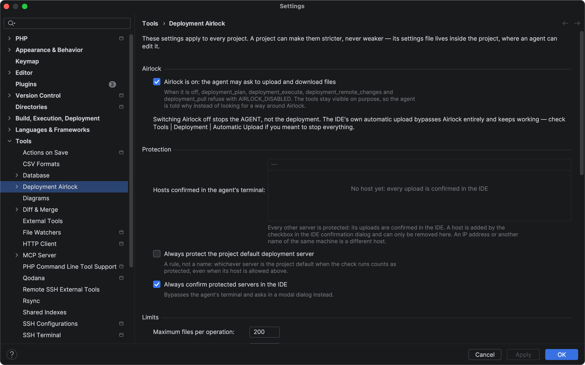
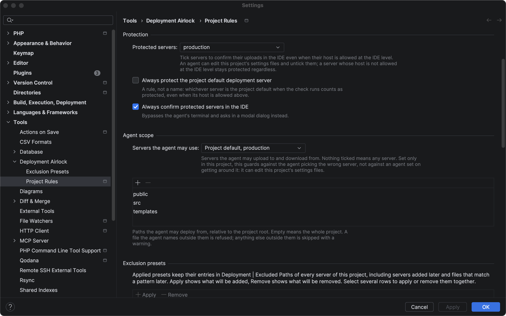
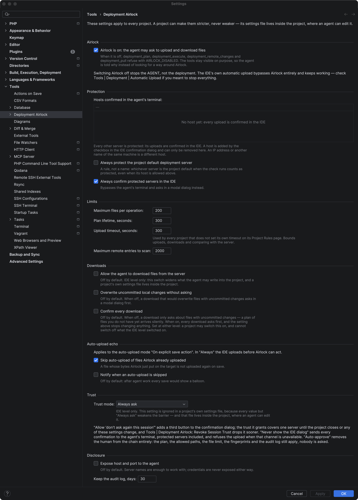
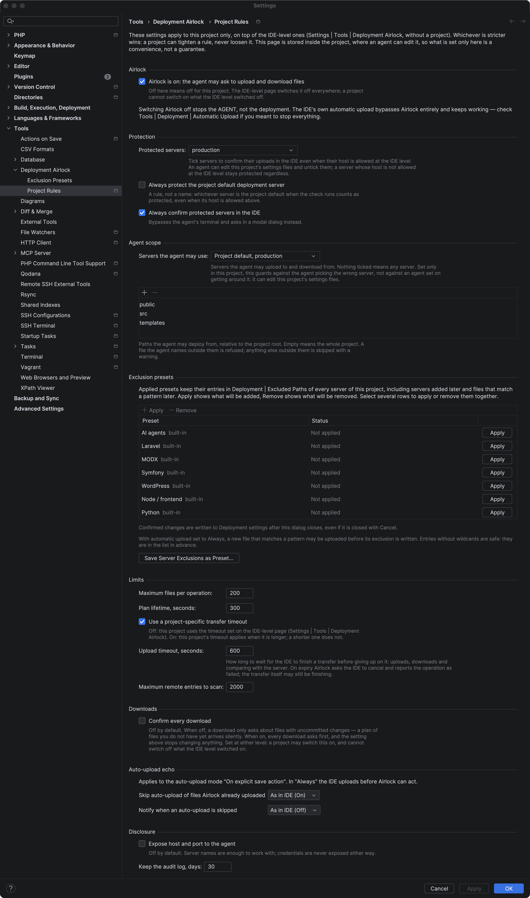
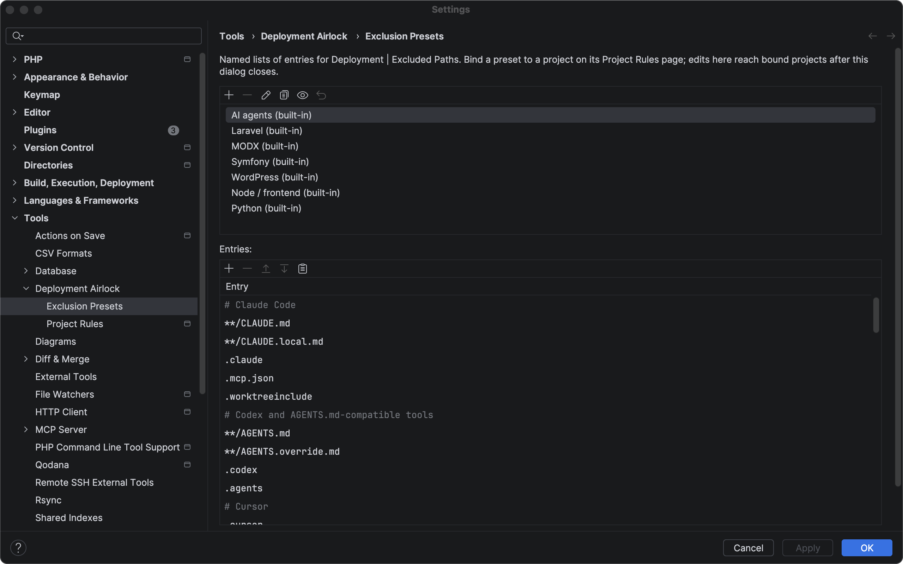

# Deployment Airlock settings

← Back to [Deployment Airlock](../../README.md)

Settings live at the IDE level (**Settings | Tools | Deployment Airlock**) and at the project level
(**… | Project Rules**, stored in `.idea/deployment-airlock.xml`).

The split is forced, not a convenience. The project's settings file sits inside the project, and
the platform picks up external edits to it — so every weakening a project file can express is a
weakening the agent can grant itself. The effective policy is therefore `strictest(app, project)`,
merged field by field, and the project level can only tighten (the one exception is [Auto-upload echo](#auto-upload-echo), where no value weakens the barrier).

This page lists every setting in the order the pages show them. For each one: the label as it
appears in the IDE, then its default, its range, the pages it is on and how the two levels merge.

## Where the settings are

| Page | Path | Applies to | Stored in |
| --- | --- | --- | --- |
| IDE level | **Settings \| Tools \| Deployment Airlock** | every project | `options/deployment-airlock-app.xml` in the IDE's configuration directory, outside any project |
| Project level | **Settings \| Tools \| Deployment Airlock \| Project Rules** | this project | `.idea/deployment-airlock.xml`, inside the project |

**The IDE-level page has no Protected servers and no Agent scope group.** Outside a project there is
no server list and no directory tree to pick from, so those settings exist on Project Rules only.

**Strictness set only in the project is a convenience, not a guarantee.** An agent can lift it by
rewriting `.idea/deployment-airlock.xml`; the guarantee is what the IDE level holds. That is why the
settings that weaken the barrier — the trust mode and the two download switches — exist at the IDE
level only.

## Airlock

**Airlock is on: the agent may ask to upload and download files**\
Default: on · Pages: both · Merge: AND — a project can switch it off, never on

When it is off, `deployment_plan`, `deployment_execute`, `deployment_remote_changes` and
`deployment_pull` refuse with `AIRLOCK_DISABLED`. The tools stay visible, so the agent is told why
instead of looking for another way. Switching Airlock off stops the agent, not the deployment: the
IDE's own automatic upload does not go through Airlock and keeps working.

## Protection

**Hosts confirmed in the agent's terminal:**\
Default: none · Pages: IDE level · Merge: none — only the IDE level is read

Every server whose host is not on this list is protected. A host is added by the checkbox in the
IDE confirmation dialog and removed here. An IP address or another name of the same machine is a
different host. The project page does not have this list: a project settings file is writable by an
agent, and a host allowed there would be a relaxation an agent grants itself. See
[Protected servers](how-it-works.md#protected-servers).

**Protected servers:**\
Default: none · Range: the project's deployment servers · Pages: Project Rules · Merge: union

A ticked server is confirmed in a dialog inside the IDE even when its host is allowed. Set only in
the project, the tick is a convenience: an agent can edit the project's settings file and untick
it. A ticked name that no longer matches any server is flagged on the page and reported to the
agent. See [Protected servers](how-it-works.md#protected-servers).

**Always protect the project default deployment server**\
Default: off · Pages: both · Merge: OR

A rule, not a stored name: whichever server is the project default when the check runs counts as
protected, even when its host is allowed. It follows the default server when that changes. It is off
by default because the empty host list already protects every server.

**Always confirm protected servers in the IDE**\
Default: on · Pages: both · Merge: OR

With it on, a protected server is confirmed in a modal dialog rather than in a form in the agent's
terminal. It concerns protected servers only; it does not put every server behind a dialog.

## Agent scope

**Servers the agent may use:**\
Default: nothing ticked, meaning any server · Range: the project's deployment servers · Pages:
Project Rules · Merge: each level's list applies — a server must be allowed by both

The servers the agent may upload to and download from. Any other one is refused with
`SERVER_NOT_ALLOWED`, and the message lists what is allowed. The first entry, **Project default server
(now: …)**, is a rule rather than a name: it follows the default chosen in Deployment settings.

**The list of paths under it** (its comment begins *Paths the agent may deploy from, relative to the
project root*)\
Default: empty, meaning the whole project · Range: the project's directories · Pages: Project Rules ·
Merge: intersection of the zones

A file the agent names outside these paths is refused with `PATH_NOT_ALLOWED`; a file collected by
`changed_files` outside them is skipped with a warning. See
[The agent's path zone](how-it-works.md#the-agents-path-zone).

## Limits

**Maximum files per operation:**\
Default: 200 · Range: 1–10 000 · Pages: both · Merge: min

A plan with more files is refused with `TOO_MANY_FILES`.

**Plan lifetime, seconds:**\
Default: 300 · Range: 30–3 600 · Pages: both · Merge: min

How long a plan stays valid. An expired plan cannot be executed; the agent has to build a new one.

**Use a project-specific transfer timeout**\
Default: off · Pages: Project Rules · Merge: off — the IDE-level timeout applies; on — this
project's does, but only when it is longer

The field below it is editable only while this is ticked.

**Upload timeout, seconds:**\
Default: 300 · Range: 30–7 200 · Pages: both · Merge: the IDE-level value, or the longer of the two
when the checkbox above is ticked

How long Airlock waits for the IDE to finish a transfer before giving up on it. Despite the label,
it bounds every transfer: uploads, downloads and comparing with the server. On expiry Airlock asks
the IDE to cancel and reports the operation as failed; the transfer itself may still be finishing,
so the server stays locked until the IDE restarts. The merge is not a minimum: the timeout is about
a project's network, not about safety, and a shorter one is not stricter. A project may only
lengthen it: a shorter timeout written into the project file protects nothing, yet fails honest
transfers and locks the server until the IDE restarts.

**Maximum remote entries to scan:**\
Default: 2 000 · Range: 1–100 000 · Pages: both · Merge: min

How many entries on the server `deployment_remote_changes` may walk in one call. Files and visited
directories count alike, so the limit can stop the walk with fewer files found than the number set.
When it does, the answer says the comparison is incomplete.

## Downloads

**Allow the agent to download files from the server**\
Default: off · Pages: IDE level only · Merge: IDE level only

While it is off, `deployment_remote_changes` and `deployment_pull` refuse with `PULL_DISABLED`. It
exists at the IDE level only because it widens what the agent may write into the project. See
[Downloading from the server](how-it-works.md#downloading-from-the-server).

**Overwrite uncommitted local changes without asking**\
Default: off · Pages: IDE level only · Merge: IDE level only

When off, a download that would overwrite files with uncommitted changes stops at a modal dialog
first.

**Confirm every download**\
Default: off · Pages: both · Merge: OR

When off, a download asks only about files with uncommitted changes, and a plan of files the project
does not have yet arrives silently. When on, every download asks first, and the setting above stops
changing anything. A project may switch it on, and cannot switch off what the IDE level switched on.

## Auto-upload echo

Applies to the auto-upload mode **On explicit save action**. In **Always** the IDE uploads a change
the moment it sees it, before Airlock can act, so these options have no effect there.

After Airlock uploads files, the IDE's own auto-upload would send the same files again
on the next save: it queues every change and knows nothing about what Airlock did. These options stop
exactly that repeat. A file is skipped only when Airlock knows its current bytes are already on every
server auto-upload targets; a file edited after the transfer is uploaded as before. Each skip is
written to the audit log as `autoUploadSkipped`. Airlock does not otherwise touch auto-upload, and
the warning about it stays. The memory lasts while the project is open and is cleared by any change
to the deployment configuration. With Airlock switched off nothing is skipped. Files Airlock
downloads are not sent back in any mode: the IDE itself skips the files of its own transfers.

**Skip auto-upload of files Airlock already uploaded**\
Default: on · Pages: both · Merge: the project overrides the IDE (project: As in IDE / On / Off)

A file whose bytes Airlock just put on the target is not uploaded again on save.

**Notify when an auto-upload is skipped**\
Default: off · Pages: both · Merge: the project overrides the IDE (project: As in IDE / On / Off)

Off by default: after agent work every save would show a balloon.

**Unlike every other setting here, the project may relax these as well as tighten them.** No value
weakens the barrier: with the option on, only what is already on the same servers with the same
content is skipped; with it off, the repeat returns, and nothing new is sent either way. An agent
gains nothing by rewriting the field. On Project Rules each option is a choice of **As in IDE (On)**
or **As in IDE (Off)** (showing the IDE value), **On**, **Off**; the IDE page has plain checkboxes.

## Trust

**Trust mode:**\
Default: Always ask · Pages: IDE level only · Merge: IDE level only — a value in the project's file
is ignored

- **Always ask** — every upload is confirmed.
- **Allow "don't ask again this session"** — the confirmation dialog gets a third button that trusts
  one server until the project closes, any Airlock setting changes, or you revoke it.
- **Never show the IDE dialog** — every confirmation goes to the agent's terminal, protected servers
  included; if that channel is unavailable, or its answer is not a plain yes or no, the upload is
  refused.
- **Auto-approve, never ask** — nobody is asked. The plan, the allowed paths, the file limit, the
  content fingerprints and the audit log still apply.

See [Trust modes](how-it-works.md#trust-modes) for why they exist and what each one costs.

## Disclosure

**Expose host and port to the agent**\
Default: off · Pages: both · Merge: AND

Server names are enough for the agent to work with. With this on, `deployment_servers` also returns
each server's host and port. Credentials are never exposed either way.

**Keep the audit log, days:**\
Default: 30 · Range: 1–365 · Pages: both · Merge: max

How long the audit log files are kept. The log is the only trace an upload leaves, so the longer of
the two levels wins.

Both pages in full, the IDE level first:

## Exclusion presets

A preset is a named list of path patterns for **Deployment | Excluded Paths**, set up once at the IDE
level and bound to a project. While it is bound, Airlock keeps its entries in the excluded paths of
every server of the project, including servers added later and files that appear later. A preset adds
exclusions; only your own action in the settings removes them, so a preset cannot let anything new leave the
machine on its own. Built-in presets: **AI agents**,
**Laravel**, **MODX**, **Symfony**, **WordPress**, **Node / frontend**, **Python**. Review what a
preset holds before you bind it.

**Settings | Tools | Deployment Airlock | Exclusion Presets** (IDE level) edits the presets. The list
marks **built-in**, **modified** and **hidden** ones. Its toolbar has **+** (New…), **−** (Delete,
your own presets only), the pencil (Rename…), **Clone…**, **Hide** / **Show** (built-in ones can be
hidden, not deleted) and **Reset to Default** (a modified built-in one). The entries of the selected
preset are in the **Entries:** table, one entry per row. Its toolbar has **+** (a new row after the
selected one, or at the end when nothing is selected, ready to type in), **−** (the selected rows), up and down (the order is kept) and **Paste List…**, which takes
a list of lines and adds them after the existing entries; spaces around a line are removed and empty
lines are skipped. A bad entry is shown in red with the reason in its tooltip and in the **Line N: …**
list under the table (N is the row number); it is skipped, the rest of the preset still works.
Comment rows (`#`) are shown in grey. Unmodified built-in presets follow plugin updates.

**Entry syntax.** A path from the project root with `/`. A segment is a name (`docs`, `CLAUDE.md`), a
glob (`*`, `?`, for example `.aider*`), `**` for any depth (`**/CLAUDE.md`), or `re:<regex>` matched
against the whole name (`re:\.php-cs-fixer(\.dist)?\.php`). `{projectName}` and `{projectNameLower}`
work inside a name. Lines starting with `#` are comments. Write paths without `./` and with `/` only:
a `.` segment or a `\` outside `re:` is flagged as an error, because the platform would never match
such an entry. Case follows the platform: where the file
system ignores case (macOS by default), `Tests` and `tests` are the same entry. An entry without
wildcards is written even if the file does not exist yet; an entry with wildcards is expanded into
the paths that exist and then watched for new matches.

**Project Rules | Exclusion presets** (project level) is a table of the presets: **Preset** (with
**built-in** and **modified** marks), **Status** and a button in each row. A preset that is not applied
shows **Not applied** and **Apply**; an applied one shows **Applied · N entries** and **Remove**, where N
is the number of entries the preset keeps in the excluded paths, summed over the project's servers (an
entry two presets share counts for both; one path on two servers counts twice). **Apply** opens a
preview, per server, of what will be added (an entry you removed from that server earlier is marked
**(you removed this earlier)**: applying brings it back); **Remove** opens a preview of what will be
removed. After you confirm, the row says **Will be applied after Settings close** or **Will be removed
after Settings close**, and its button offers the opposite action, so you can change your mind before
closing Settings. **Apply** and **Remove** above the table act on every selected row (Shift or ⌘/Ctrl
to select several): one preview for all of them, one confirmation, and each entry is marked with the
preset it belongs to. Rows the action does not fit are skipped. Binding is stored in `workspace.xml`,
per user, not in version control.

**Save Server Exclusions as Preset…** (the button under the table, and an item in the Project view
context menu) turns the excluded paths of one project server into a new preset; entries outside
the project or on the remote side are skipped and counted.

How it behaves:

- **An entry you removed stays removed.** If you delete an entry a preset added, from the IDE's
  Deployment dialog or with **Include in Deployment**, no preset adds it back to that server until you
  bind a preset again and approve it in the preview. The same holds for an entry you had added by hand
  that a bound preset also wants: once you remove it, the preset does not add it back.
- **Paths beneath a removed folder entry stay excluded.** If you remove an entry such as `.claude` that
  covered paths of a bound preset (`.claude/settings.local.json`, a `CLAUDE.md` inside it), Airlock adds
  those paths to that server's exclusions right away, once Settings are closed. The entry you removed
  is not added back, and neither is a path beneath it that you had removed earlier.
- **Only a person's action removes entries**: **Remove** in the table, or editing a preset while the
  project is open. Entries you added by hand are never removed, and an entry another bound preset needs stays.
  Opening a project only adds. A preset edited while the project was closed leaves the entries of its
  removed lines in place: reopening the project does not remove them, editing that preset again with
  the project open does.
- **A bound preset that is no longer available in this IDE** (hidden or deleted) stays in the table as
  **Not available in this IDE** with a **Forget** button; the toolbar does not act on it. Forget only
  drops the binding: the entries stay on the servers and become manual, so no preset owns them. If
  the preset was shown again on the Exclusion Presets page in the meantime, Forget refuses and asks
  you to use **Remove**, which shows what will be removed.
- **Writes happen after Settings closes**, even if you close it with Cancel: the Deployment page in
  the same dialog rewrites all excluded paths when you press OK and would erase them. Confirmed
  changes show a note about this, and the table marks them as pending. Settings can stay open next to the editor, so this covers every
  write of a preset, not only the ones you confirm: new matching files, a new server and an edited
  preset are written once no Settings window of the project is open.
- **Watching covers new files and folders** that the IDE sees (created, copied, moved, renamed) under
  the project root; directories already excluded on every server are not walked, symlinks are not
  followed, and files created outside the IDE appear when the IDE notices them.
- **Automatic upload set to Always can win the race**: a new file matching a pattern may be uploaded
  before its exclusion is written. Entries without wildcards are safe, they are in the list in advance.
- Only the project's own servers are changed, and only the local half of their lists. Agents cannot
  change presets through Airlock: like the Project view items, this is a person's setting, and it is
  not written to the audit log.

## Files and the audit log

- IDE-level settings: `options/deployment-airlock-app.xml` in the IDE's configuration directory.
- Project settings: `.idea/deployment-airlock.xml` in the project.
- Exclusion presets: `options/deployment-airlock-presets.xml` in the IDE's configuration directory (only what differs from the built-in ones). Which presets a project uses: `workspace.xml`, per user.
- Audit log: `modxkit-airlock/audit-<project>-<yyyy-MM-dd>.jsonl` in the IDE's log directory — open
  it with **Help | Show Log in Finder** (**Show Log in Explorer** on Windows). One JSON line per
  event, one file per day (UTC); files older than **Keep the audit log, days:** are deleted.
  Credentials are never written to it. If a line cannot be written, Airlock shows an error
  notification with the reason; transfers continue, but they are not recorded until it is fixed.

## Commands

**Tools | Deployment Airlock: Revoke Session Trust** drops the trust granted with the
"don't ask again this session" button, for every server, before the project closes. The next upload
asks again.
